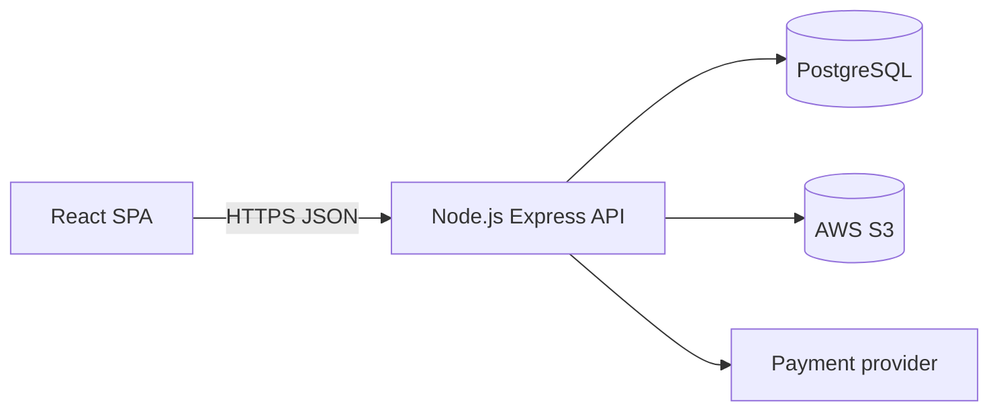

# Design: Music Streaming Platform

## Overview

Resonance is a full-stack music streaming web app. Listeners stream music, create playlists, mark songs as liked and get personalized recommendations; uploaders submit their own songs with audio, cover image and metadata; admins review uploads and manage users. Full catalog access costs 20 euros a month. The app runs on React (frontend), Node.js (backend API), PostgreSQL (database) and AWS S3 (audio and cover storage), and deploys to AWS.

The app is a single web app for all three roles. A person opens `/` and, when not signed in, sees the sign-in page. After signing in, a listener or uploader lands on the home page, and an admin lands on the admin dashboard. The app is in Spanish and English, uses the Madrid time zone and the euro, and meets WCAG 2.2 AA.

## Architecture

A single-page React app talks to a Node.js (Express) REST API over JSON. The API owns all business rules and is the only thing that touches PostgreSQL and S3. Audio and cover files are stored in S3; the database stores their keys and all metadata.

- **Frontend** — React SPA with client-side routing. A shared app shell (sidebar, top bar, fixed player bar) wraps every signed-in screen. The player state lives in a client-side store so playback continues as the user navigates.
- **Backend** — Express API under `/api`, with JWT authentication, role checks (listener, uploader, admin), and a scheduled job that recalculates recommendations daily at midnight.
- **Database** — PostgreSQL, accessed through an ORM with migrations.
- **Storage** — AWS S3 for audio files and cover images, with signed upload URLs so files never pass through the API.
- **Payments** — an external payment provider handles cards; the app never stores card data.

## Components and Interfaces

### App shell (shared)

- **Sidebar** — brand mark and name, "Browse" group (Home, Search, Your Library), "Playlists" group (Create playlist, Liked Songs). Hidden on mobile; a mobile top bar shows the brand and the avatar instead.
- **Top bar** — page title and the signed-in user's avatar.
- **Player bar** — fixed at the bottom on every signed-in screen: current song cover, title and artist, play/pause, next, previous, shuffle, repeat, a progress bar, and volume. On mobile it collapses to the now-playing info and controls.

### Screens and routes

| Route | Screen | Who sees it |
| --- | --- | --- |
| `/` | Sign in / sign up | anyone |
| `/home` | Home page and discovery | listener, uploader |
| `/search` | Search | listener, uploader |
| `/player` | Now playing | listener, uploader |
| `/library` | Your Library (playlists, liked songs) | listener, uploader |
| `/playlist/:id` | Playlist detail | listener, uploader |
| `/album/:id` | Album detail | listener, uploader |
| `/artist/:id` | Artist detail | listener, uploader |
| `/upload` | Upload a song | uploader |
| `/my-songs` | Manage uploaded songs | uploader |
| `/profile` | User profile | listener, uploader |
| `/admin` | Admin dashboard | admin |

### API areas

- **Auth** — sign up, sign in, sign out, consent to data treatment.
- **Catalog** — songs, albums, artists, genres; search.
- **Playback** — stream a song, record a listen.
- **Library** — playlists, liked songs.
- **Recommendations** — personalized and popular selections.
- **Uploads** — create, edit, delete a song; signed S3 upload URLs.
- **Admin** — pending review list, approve/reject, user management, settings (price, genres, home texts).
- **Subscription** — subscribe, cancel, status.
- **Profile** — account data, delete account.

## Data Models

- **User** — id, name, email, password hash, role (listener, uploader, admin), subscription state, consent flag, created/closed dates.
- **Song** — id, title, artist, album, genre, audio key, cover key, duration, state (pending, approved, rejected), rejection reason, uploader id, submitted/approved dates.
- **Album** — id, title, artist, cover key.
- **Artist** — id, name.
- **Playlist** — id, name, owner id, ordered song list.
- **LikedSong** — user id, song id.
- **Listen** — user id, song id, timestamp (drives recommendations).
- **Recommendation** — user id, song id, computed date.
- **Setting** — key, value (subscription price, genres, home page texts).
- **AuditLog** — actor, action, target, timestamp (who uploaded/approved/rejected each song).

## Error Handling

The API returns JSON errors with an HTTP status and a message. The frontend shows each screen's error state with a "Try again" action. Upload validation failures (wrong format, too large) show a message naming the allowed formats and size. Sign-in failures show "Email or password is incorrect." Rejected uploads carry a reason the uploader is notified of.

## Testing Strategy

- **Unit tests** — business rules: playlist deduplication, recommendation recalculation, upload validation, review-state transitions, subscription access.
- **API tests** — each endpoint, with a throwaway PostgreSQL database the test setup starts and removes, and S3 calls mocked.
- **End-to-end journeys** — Playwright, saved in `e2e/`, run through `run_journeys` against the running app.

## Build and run

Install: npm install
Test: npm test
Run locally: yes
Dev: npm run dev
Port variable: PORT
Health path: /api/health
Deploy: aws

## Test logins

- listener@example.com / listener123 — listener
- uploader@example.com / uploader123 — uploader
- admin@example.com / admin123 — admin

## Assumptions

- The frontend and backend live in one repository with two workspaces (a `web` app and a `server` app), installed and tested together from the root.
- The player is a client-side store so playback and the queue survive navigation; background playback uses the browser's media session.
- Recommendations are a daily job that scores songs by the user's listen history; with no history the home page shows popular songs.
- The payment provider is mocked in local and test runs; the real provider is configured only in production.
- S3 is the secure cloud storage for audio and cover files; the app stores only their keys.

## Look and feel

The approved mock-ups: `agent_generated/ui-preview/sign-in.html`, `agent_generated/ui-preview/home.html`, `agent_generated/ui-preview/search.html`, `agent_generated/ui-preview/player.html`, `agent_generated/ui-preview/admin-dashboard.html`. Their colours and font are in `.nexgile/greenfield/tokens.json`; build the screens with them.

- Font: Poppins, Inter, system-ui, -apple-system, Segoe UI, Roboto, sans-serif
- Colours:
  - primary: `#7c3aed`
  - primary-hover: `#6d28d9`
  - on-primary: `#ffffff`
  - background: `#0f172a`
  - surface: `#1e293b`
  - surface-variant: `#334155`
  - text: `#f8fafc`
  - text-muted: `#94a3b8`
  - outline: `#475569`
  - outline-variant: `#334155`
  - focus-ring: `#c4b5fd`
  - error: `#f87171`

- Sign-in page: full-screen animated gradient background with floating music-note shapes, a subtle particle effect, and a glassmorphism sign-in card with smooth entrance animations.
